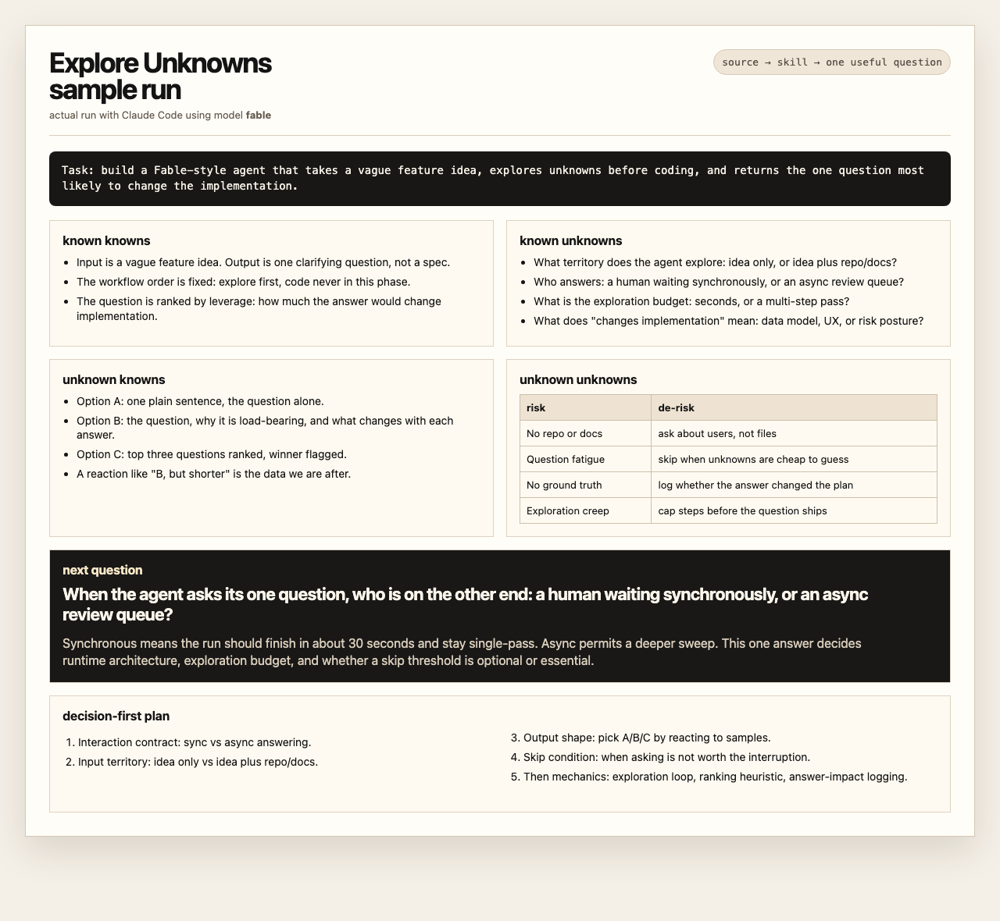

# Superflux Labs

Small, runnable agent skills, proof artifacts, and runbooks for agent workflows that finish with evidence.

This repo has two public lanes:

- **Skills and proof artifacts** — portable agent skills with validation, source credit, and sample-run proof.
- **Agent runbooks** — operating procedures for repeatable agent workflows: coding loops, review loops, documentation loops, research loops, and the safety rails that keep them from drifting forever.

## Public labs

### `explore-unknowns`

A portable skill based on Thariq Shihipar's public Fable article, “A Field Guide to Fable: Finding Your Unknowns.”

It turns ambiguous or long-horizon agent work into a four-quadrant unknowns map before the agent starts guessing:

- known knowns;
- known unknowns;
- unknown knowns;
- unknown unknowns;
- decision-first plan;
- implementation notes;
- sample-run proof and merge quiz.

#### Install / smoke-test locally

```bash
npm install
npm run validate
```

#### Install into Claude Code + Codex with the Skills CLI

```bash
npx -y skills add . --skill explore-unknowns --agent claude-code codex --copy -y --full-depth
```

Expected locations:

- `.claude/skills/explore-unknowns/`
- `.agents/skills/explore-unknowns/`

#### Install into Hermes Agent for local testing

```bash
TMP_HERMES=$(mktemp -d)
mkdir -p "$TMP_HERMES/skills"
cp -R skills/explore-unknowns "$TMP_HERMES/skills/explore-unknowns"
HERMES_HOME="$TMP_HERMES" hermes skills list | grep -i explore-unknowns
```

#### Proof

See [`content/proof/explore-unknowns/2026-07-06-sample-run.md`](content/proof/explore-unknowns/2026-07-06-sample-run.md).



### `write-through-problems` — Recursive Thought Writing

An original process created by Kandarp Jani in March 2023 and now packaged as a portable agent skill.

It prevents a messy note from collapsing into the first plausible answer:

- capture every question, idea, observation, constraint, and reaction without filtering;
- transform each item into a test, investigation, evidence check, or accepted boundary;
- map named islands of subproblems and the edges between them;
- zoom out through a real or synthetic diffuse pass;
- recurse with a finite budget and socialize one concrete artifact;
- graduate into a decision brief, experiment, architecture note, specification, or outline.

#### Install into Claude Code + Codex

```bash
npx -y skills add . --skill write-through-problems --agent claude-code codex --copy -y --full-depth
```

#### Install into Hermes Agent for local testing

```bash
TMP_HERMES=$(mktemp -d)
mkdir -p "$TMP_HERMES/skills"
cp -R skills/write-through-problems "$TMP_HERMES/skills/write-through-problems"
HERMES_HOME="$TMP_HERMES" hermes skills list | grep -i write-through-problems
```

The package includes a reusable [recursive thought map](skills/write-through-problems/templates/recursive-thought-map.md), a [source ledger](skills/write-through-problems/references/source-ledger.md), and [failing-first evaluations](evals/skill-quality/write-through-problems/expected-behavior.md).

#### Proof

See the passing [Quick-mode sample run](content/proof/write-through-problems/2026-07-25-sample-run.md): 1,076 words, 16/16 rubric, no hard failures.

### Reader-first skills: `cognitive-render`, `explaining-with-html` and `sf-learning`

Three packages by Kandarp Jani for one problem: agents finish the work faster than a person can read what they report. `cognitive-render` writes the words, `explaining-with-html` draws the page, and `sf-learning` turns the moments the reader gets lost into rule changes for both, with the reader's approval.

#### `cognitive-render`

Writing rules for anything an agent writes to explain - summaries, briefs, status updates, root-cause analyses:

- give the answer first, then the detail;
- every important sentence names who acted, on what, and what changed;
- concise, not compressed: cut filler, never the actor, the condition or the result;
- no invented labels and no analogies the reader did not ask for;
- a twelve-step reading check plus a deterministic verifier script before delivery.

```bash
npx -y skills add . --skill cognitive-render --agent claude-code codex --copy -y --full-depth
npm run test:cognitive-render
```

Proof: [plain-wording sample](content/proof/cognitive-render/sample-run.md).

#### `explaining-with-html`

For answers too big for a chat reply. The skill builds one self-contained HTML page:

- the answer in one sentence, then one picture of how it works;
- every section opens on a figure with a caption of at most two sentences;
- evidence, file paths and long tables fold into expanders;
- at most 1,200 visible words, checked by `assets/page-budget-check.mjs`;
- fixed colour meanings and one copy-ready reply at the end of every review page.

It uses `cognitive-render`'s writing rules. Fonts are embedded so pages render offline.

```bash
npx -y skills add . --skill explaining-with-html --agent claude-code codex --copy -y --full-depth
npm run test:explaining-with-html
```

Proof: [same facts, rebuilt picture-first](content/proof/explaining-with-html/sample-run.md) - 3,101 visible words and 0 figures became 1,058 and 7.

#### `sf-learning` (plugin)

Learns writing rules from the moments you get lost:

- a hook captures each prompt you type with the agent reply it reacts to, on your machine, with secrets removed first;
- `/sf-learning:process` sorts each prompt: a missing rule, a rule too vague to help, a clear rule that was ignored, or not about writing;
- a problem seen in two different sessions becomes a proposal on a review page;
- nothing changes a skill without your approval, and one guarded script writes only on a `sf-learning/propose-*` branch.

Install in Claude Code:

```bash
/plugin marketplace add SuperfluxExp/superflux-labs
/plugin install sf-learning@superflux-labs
```

Codex reads the same plugin from `.agents/plugins/marketplace.json`. sf-learning proposes changes to `skills/cognitive-render/SKILL.md` and `skills/explaining-with-html/SKILL.md` in the repository you run it from.

```bash
npm run test:sf-learning
```

Proof: [one month of real use](content/proof/sf-learning/sample-run.md) - 104 problems across 52 sessions, 19 that changed nothing, 5 approved rule changes.

### Agent runbooks

AI agents do not need more prompt dumps. They need operating procedures.

A prompt says, “ask the model this.” A runbook says:

- when to use the workflow;
- what should be true at the end;
- how to verify the result;
- when to stop;
- how the workflow usually fails;
- who deserves credit if the workflow adapts someone else's public idea.

That difference matters. Teams are already handing real repos, docs, tickets, CI, customer research, and business workflows to agents. The failure mode is rarely “the prompt was ugly.” It is usually one of these:

- the agent never reproduced the bug;
- the agent shipped code without real verification;
- the agent looped because “improve this” had no stop condition;
- the agent copied a public idea without credit;
- the human got a confident summary instead of evidence.

Runbooks make the boundary explicit.

#### Loop engineering framing

The Pragmatic Engineer's [“What is loop engineering?”](https://newsletter.pragmaticengineer.com/p/what-is-loop-engineering) is a useful bar for this repo. A real agent loop is not just repeated prompting. It needs:

- a durable goal or completion condition;
- state that survives a fresh context window;
- a clear trigger, such as a human request, failing check, event, or schedule;
- verification after each pass;
- a budget, retry cap, or human gate.

This repo should treat those as part of the runbook contract.

#### Current runbooks (3/5 of the first-five corpus)

- [Architecture Satisfaction Loop](runbooks/architecture-satisfaction-loop.md)
- [Bug Reproduction Loop](runbooks/bug-reproduction-loop.md)
- [PR Babysitter Loop](runbooks/pr-babysitter-loop.md)

#### What belongs in a runbook

A good agent runbook is small enough to use and strict enough to trust.

Each runbook should include:

1. **Use when** — the exact trigger.
2. **Outcome / goal** — what should be true when the loop is done.
3. **Loop contract** — trigger, persisted state, iteration rule, budget, and human gate.
4. **Workflow** — the prompts, commands, checks, or agent instructions.
5. **Verification** — tests, live checks, review steps, artifacts, or receipts.
6. **Stop condition** — the rule that prevents endless agent motion.
7. **Failure modes** — how the workflow goes wrong and how to bound the damage.
8. **Example** — a minimal realistic case.
9. **Source / credit** — public links and acknowledgements for adapted ideas.

Runbooks can include prompts. They are not prompt libraries.

#### First five runbooks planned

These are the first five runbooks this project should grow toward.

1. **Architecture Satisfaction Loop** — repeated architecture critique and refinement, with a hard stop so “until happy” does not become infinite refactor drift.
2. **Bug Reproduction Loop** — reproduce the bug, isolate it, write or update a failing test, fix, and verify.
3. **PR Babysitter Loop** — watch CI, summarize failures, rebase when safe, fix clear flakes, and stop on permission gates.
4. **Docs Sweep Loop** — keep documentation honest by checking commands, paths, examples, and stale claims.
5. **Revenue Research Loop** — turn messy market/source research into a bounded evidence packet with a clear “what to do next” section.

## Publication safety

This repository is meant to be public. That means every change should pass two gates:

1. **Content gate** — no private context, private paths, credentials, or internal operating notes.
2. **Evidence gate** — every skill, proof artifact, or runbook needs verification steps and stop conditions.

The CI workflow runs a repository scan on pull requests, pushes, and a recurring schedule. It looks for high-confidence private terms, local machine paths, secret-looking strings, and accidental internal artifact references.

The scan is a guardrail, not a replacement for human review.

## How to contribute a runbook

1. Start with a workflow that you have actually used or can explain concretely.
2. Write the trigger and expected outcome first.
3. Add verification before adding clever prompts.
4. Add a stop condition.
5. Name the failure modes.
6. Credit public sources.
7. Keep private context out.

If you are not sure whether something belongs in public, leave it out and link to a generic pattern instead.

## Builder CTA

If this helps, star or watch the repo.

If you have a workflow pain that agents keep mishandling, open an issue or suggest a runbook.

If a runbook fails, produces weak evidence, or prevents an unsafe action, open a Runbook feedback issue with public or invented details only.

The best contributions are not shiny prompts. They are repeatable loops that leave evidence.

## Source and credit

The `explore-unknowns` package is a source-grounded skill package, not an article mirror. It credits the public source, preserves short excerpts in a ledger, and converts the idea into a runnable agent workflow. It does not imply endorsement from Thariq, Anthropic, David/dzhng, or Fable.

The `write-through-problems` package publishes Kandarp Jani's own March 2023 Recursive Thought Writing process with his explicit permission. The original presentation is not included; the public package contains the attributed method, agent adaptations, template, and evaluations.

The reader-first skills (`cognitive-render`, `explaining-with-html`, `sf-learning`) are Kandarp Jani's own packages, published with his permission. The verifier's phrase checks adapt Hardik Pandya's [stop-slop](https://github.com/hardikpandya/stop-slop) (MIT). The STE-inspired writing rules reference [ASD-STE100 Issue 9](https://www.asd-ste100.org/assets/files/ASD-STE100_ISSUE9.pdf) and do not claim compliance with it. `explaining-with-html` embeds Instrument Sans and IBM Plex Mono under the SIL Open Font License.

The first seed for Agent Runbooks came from public discussion around Peter Steinberger's Architecture Satisfaction Loop, including Loop Library's [Architecture Refactoring Loop for Coding Agents](https://signals.forwardfuture.com/loop-library/loops/architecture-satisfaction-loop/), and the broader idea of repeatable agent loops.

The loop-engineering framing also credits Gergely Orosz's Pragmatic Engineer article, [“What is loop engineering?”](https://newsletter.pragmaticengineer.com/p/what-is-loop-engineering), especially the distinction between one-off prompts and durable goals with state, verification, context resets, and stop conditions.

The PR Babysitter Loop credits public prior art from `openai/codex` and `novotnyllc/babysit-pr` while keeping this repository's runbook a clean-room operating procedure.

Good credit makes the corpus better. It lets builders trace where ideas came from, compare variants, and improve the workflow without pretending it appeared from nowhere.
