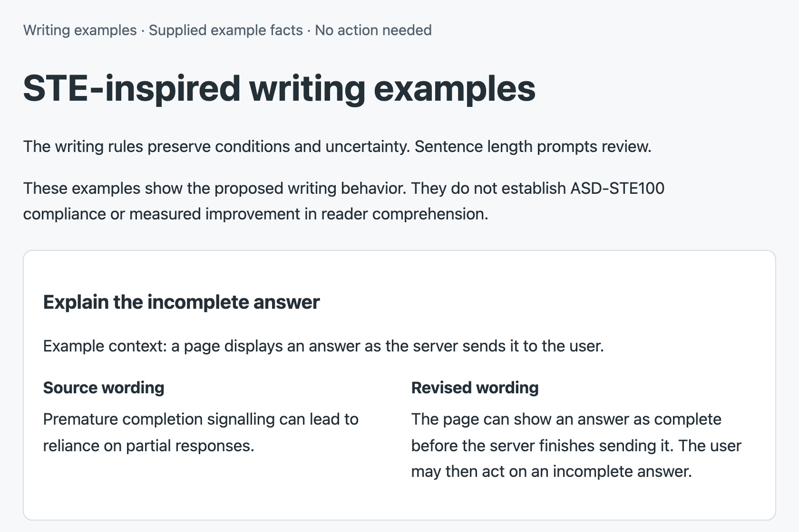

# cognitive-render: sample output

The skill rewrites compressed agent prose into sentences a reader can act on the first time. The example below comes from the skill's own examples page and uses supplied example facts.



| Source wording | Revised wording |
|---|---|
| Premature completion signalling can lead to reliance on partial responses. | The page can show an answer as complete before the server finishes sending it. The user may then act on an incomplete answer. |

What changed:

- the actor (the page) and the object (the answer) are named;
- the condition (before the server finishes) is stated before the result;
- “can” stays “can”: the rewrite keeps the source's uncertainty instead of turning it into a certainty.

## Check it yourself

```bash
npm run test:cognitive-render
```

The verifier in `skills/cognitive-render/scripts/verify-human-readable-output.mjs` flags stock AI phrases, compressed sentences, jagged fragments, walls of text and drafts that exceed the reader's time budget. It is a guardrail, not proof of understanding: the skill still requires a first-time-reader pass before delivery.
