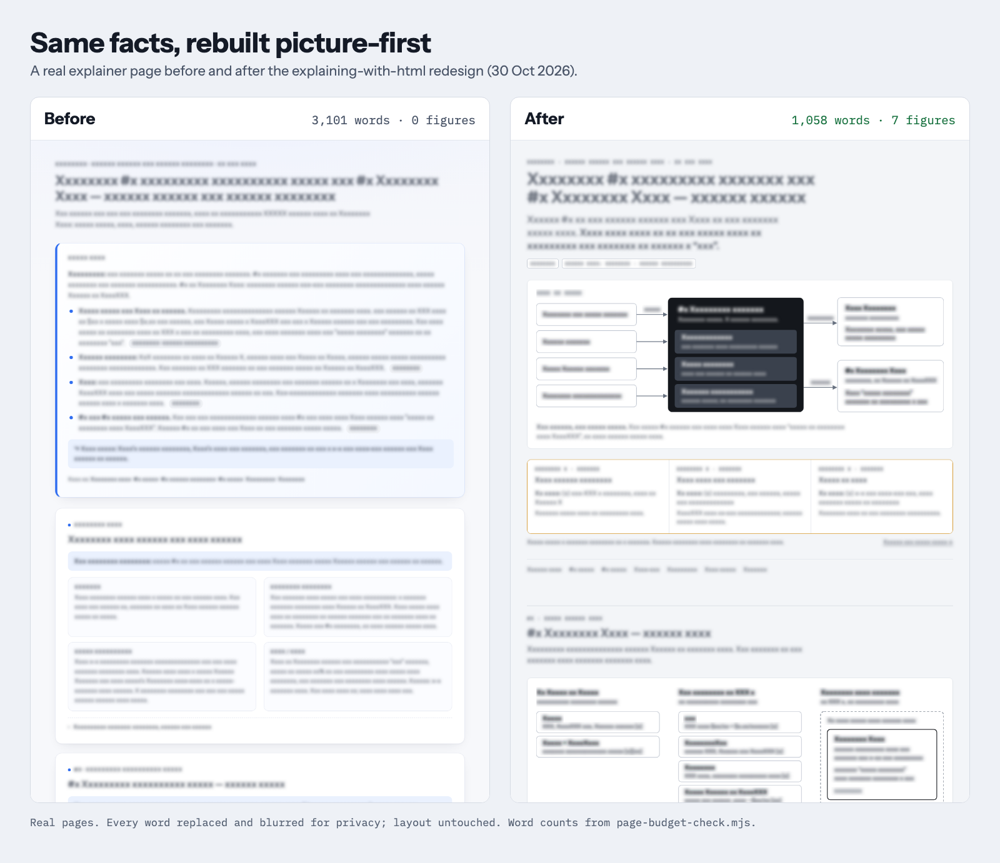
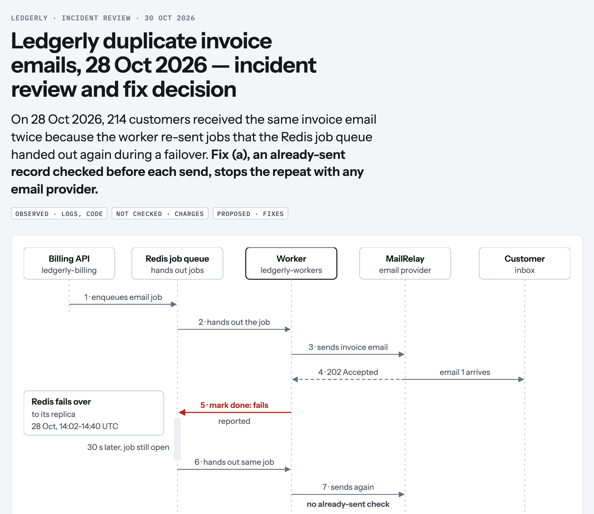

# explaining-with-html: sample output

## Same facts, rebuilt picture-first

A real explainer page before and after the skill's picture-first redesign (30 Oct 2026). Every word on both pages was replaced and blurred before the screenshot; only the layout is visible. The counts come from `assets/page-budget-check.mjs`.



| | Visible words | Figures |
|---|---|---|
| Before | 3,101 | 0 |
| After | 1,058 | 7 |

Every number and quoted phrase from the original page was kept in the rebuilt one.

## A picture-first page

An invented incident, written by a fresh agent that had only the skill files. The page opens with the answer in one sentence, then a sequence diagram of the failure.



## Check it yourself

```bash
npm run test:explaining-with-html
node skills/explaining-with-html/assets/page-budget-check.mjs <your-page.html>
```

The page checker fails a page that shows more than 1,200 words before any expander is opened, has a section without a figure, or has a caption longer than two sentences.
