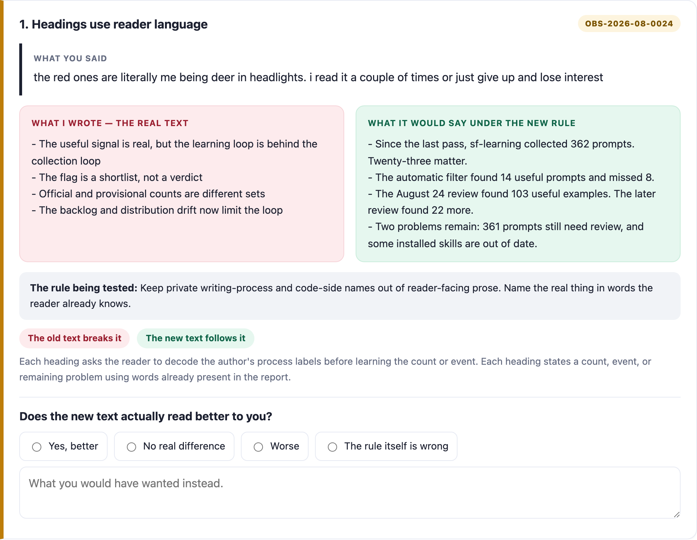
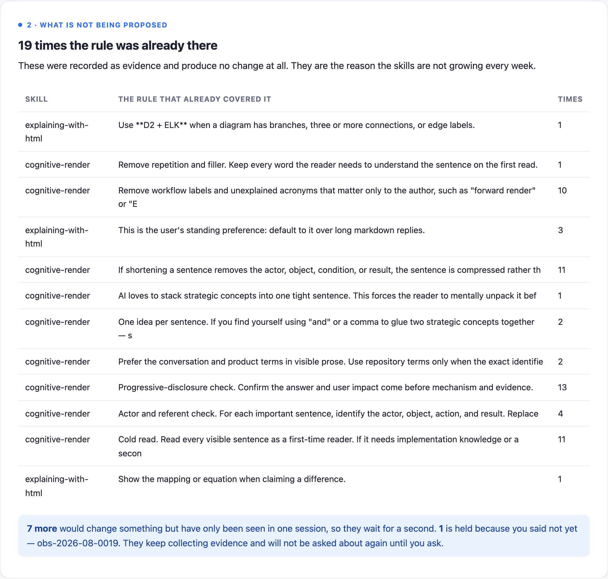

# sf-learning: sample output

These screenshots come from one month of real use (August 2026) by the author.

## A complaint becomes a rule the author approves

The quote at the top is the author's own prompt. The left panel shows headings an agent wrote; the right panel shows the same facts under the proposed rule. The card asks whether the new text actually reads better, so the rule can be reopened if it does not.



## Most complaints change nothing

When the rule already exists and the agent ignored it, the observation is kept as evidence and the skill file does not change. In August that was 19 of 27 observations, which is why the skills do not grow every week.



## The month in numbers

- 104 times an answer or a page did not work for the author, across 52 sessions;
- grouped into 27 observations;
- 19 were rules that already existed (no change);
- 5 became rule changes (1 new, 4 sharpened), each approved by the author;
- 3 are waiting for a second session or held by the author.

## Check it yourself

```bash
npm run test:sf-learning
```

Capture runs on its own. Judging is a command you run (`/sf-learning:process`). Approval is always yours, and only one guarded script can write to a skill file, only on a `sf-learning/propose-*` branch.
